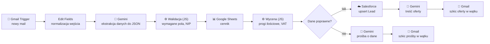

# AI Quote Agent – automatyczne oferty z maili do CRM

Agent AI zbudowany w **n8n**, który odbiera zapytania ofertowe z e-maila, wyciąga z nich dane za pomocą LLM, waliduje je, wycenia według cennika, zapisuje klienta w **Salesforce** i przygotowuje odpowiedź (ofertę albo prośbę o uzupełnienie danych) jako szkic w Gmailu do zatwierdzenia przez handlowca.

Przykładowy scenariusz: drukarnia, która dostaje zapytania typu *„Poproszę 500 ulotek A5 dwustronnie na piątek, firma X, NIP…”*.

> 🎥 **Demo:** [obejrzyj nagranie](https://youtu.be/4aqhzdX40D8)
> 📸 Zrzuty ekranu: [`docs/`](docs/)

---

## Problem biznesowy

Handlowiec dostaje dziesiątki maili z zapytaniami. Każdy trzeba przeczytać, przepisać dane do CRM, policzyć cenę z cennika i odpisać. To powtarzalna, ręczna praca, w której łatwo o pomyłkę (zły NIP, duplikat klienta, błędny próg cenowy).

**Rozwiązanie:** agent robi to w kilka sekund, a człowiek tylko sprawdza gotowy szkic i klika „Wyślij”.

---

## Jak to działa



1. **Gmail Trigger** co minutę sprawdza skrzynkę (`in:inbox is:unread -from:me`).
2. **Edit Fields** sprowadza wejście do 4 pól: `email_body`, `sender`, `thread_id`, `subject`. Reszta workflowu nie zależy od źródła, więc zmiana kanału (formularz, Outlook) wymaga tylko podmiany triggera.
3. **Gemini** wyciąga dane do ustalonego schematu JSON (klient, firma, NIP, telefon, pozycje, termin). Daty względne („do piątku”, „za tydzień”) przelicza na `YYYY-MM-DD`.
4. **Walidacja (JavaScript)** parsuje odpowiedź modelu i sprawdza reguły biznesowe: wymagane pola, poprawność ilości, sumę kontrolną NIP, termin w przyszłości.
5. **Wycena (JavaScript)** dopasowuje każdą pozycję do cennika z Google Sheets, wybiera właściwy próg ilościowy, liczy netto, VAT 23% i brutto.
6. **IF** rozdziela przepływ:
   - **poprawne dane:** upsert Leada w Salesforce, a potem szkic oferty,
   - **błędne lub niepełne dane:** szkic uprzejmej prośby o uzupełnienie, bez technicznego żargonu.
7. Odpowiedzi trafiają jako **szkice w tym samym wątku**. Nic nie wychodzi do klienta bez akceptacji człowieka.

---

## Kluczowe decyzje projektowe

| Decyzja | Dlaczego |
|---|---|
| **LLM wyciąga dane, kod podejmuje decyzje** | Model bywa niedeterministyczny (np. sam uznał papier za wymagany). Reguły biznesowe, czyli co jest wymagane i ile kosztuje, siedzą w deterministycznym JavaScripcie, więc wynik jest przewidywalny i testowalny. |
| **Human-in-the-loop** | AI przygotowuje, człowiek zatwierdza. Szkic zamiast automatycznej wysyłki eliminuje ryzyko wysłania błędnej oferty. |
| **Cennik w Google Sheets** | Handlowiec zmienia ceny bez programisty i bez dotykania workflowu. |
| **Deduplikacja po kluczu klienta** | Pole `Customer_Key__c` (External ID) = `NIP-…` albo `EMAIL-…`. Upsert aktualizuje istniejącego Leada zamiast tworzyć duplikat. |
| **Walidacja NIP sumą kontrolną** | LLM poprawnie przepisze błędny NIP, ale nie wie, że jest błędny. Kod to wyłapuje. |
| **Ustalony schemat JSON i lista produktów** | Model zwraca dane w przewidywalnym formacie (`product` z zamkniętej listy), co pozwala dopasować je do cennika. |

---

## Przykłady

**Wejście (mail):**
> Dzień dobry, potrzebuję 100 wizytówek 90x50 dwustronnie na przyszły piątek. Studio Foto Kadr, NIP 7781234327. Piotr Zieliński, tel. 511 222 333

**Wynik:**
- Lead w Salesforce: *Piotr Zieliński, Studio Foto Kadr*, z wyceną w opisie
- Wycena: 100 szt. × 40 zł/100 = **40,00 zł netto / 49,20 zł brutto**
- Szkic oferty w wątku maila

**Wejście z błędnym NIP-em:**
> Dzień dobry, proszę o 500 ulotek A5 dwustronnie. Firma Kawiarnia Ziarno, NIP 1234567890. Marta Wiśniewska…

**Wynik:** brak wpisu w CRM, szkic odpowiedzi z prośbą o sprawdzenie NIP-u.

---

## Stack

- **n8n** (self-hosted, Docker): orkiestracja
- **Google Gemini** (model Flash): ekstrakcja danych i generowanie treści
- **JavaScript** (n8n Code node): walidacja i wycena
- **Google Sheets**: cennik
- **Salesforce** (Developer Edition, OAuth2 przez External Client App): CRM
- **Gmail API** (OAuth2): odbiór maili i szkice odpowiedzi

---

## Uruchomienie

1. Uruchom n8n:
   ```bash
   docker volume create n8n_data
   docker run -d --name n8n --restart unless-stopped -p 5678:5678 \
     -e GENERIC_TIMEZONE=Europe/Warsaw -e TZ=Europe/Warsaw \
     -v n8n_data:/home/node/.n8n docker.n8n.io/n8nio/n8n
   ```
2. Zaimportuj `workflow.json` (w n8n: **Import from file**).
3. Utwórz arkusz Google z cennikiem na podstawie [`cennik.csv`](cennik.csv).
4. Skonfiguruj credentiale w n8n:
   - **Google Gemini API**: klucz z Google AI Studio
   - **Google Sheets OAuth2** i **Gmail OAuth2**: klient OAuth w Google Cloud, redirect URI `http://localhost:5678/rest/oauth2-credential/callback`
   - **Salesforce OAuth2**: External Client App z tym samym callback URL
5. W Salesforce dodaj do obiektu Lead pole tekstowe `Customer Key` (`Customer_Key__c`, Unique, External ID).
6. Aktywuj workflow i wyślij testowego maila.

> Klucze i sekrety są przechowywane wyłącznie w credentialach n8n. Eksport `workflow.json` ich nie zawiera.

---

## Ograniczenia i dalszy rozwój

- **Opportunity / Quote zamiast opisu Leada:** każde zamówienie jako osobna szansa sprzedaży z pozycjami
- **Oferta w PDF** jako załącznik do szkicu
- **Akceptacja przez Slack/Teams** zamiast szkicu w Gmailu
- **Odczyt załączników** (np. zamówienie w PDF lub Excelu)
- **Weryfikacja firmy w GUS/VIES** po NIP-ie
- **Error workflow i retry** przy limitach API (HTTP 429)
- **Zestaw testowych maili z oczekiwanymi wynikami**, żeby mierzyć jakość ekstrakcji po zmianach promptu

---

**Autor:** Albert Kistowski ·   [LinkedIn](https://www.linkedin.com/in/albert-kistowski-a0584b215/)
